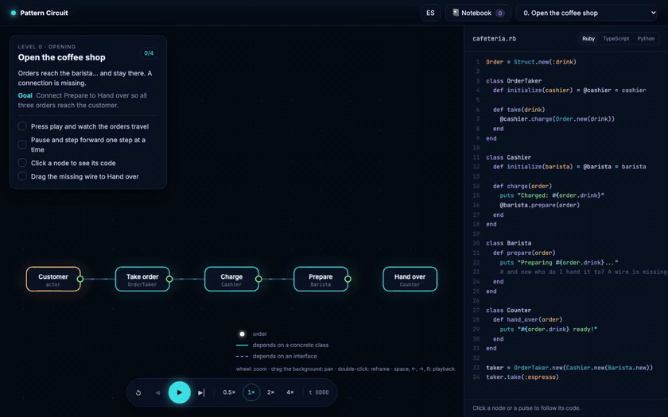

# Pattern Circuit

[](https://github.com/rodacato/pattern-circuit/actions/workflows/ci.yml)
[](https://github.com/rodacato/pattern-circuit/actions/workflows/site-pages.yml)
[](LICENSE.md)

**Play it in your browser: [rodacato.github.io/pattern-circuit](https://rodacato.github.io/pattern-circuit/)**

An educational game for understanding **design patterns by watching what they change, next to the code that does it**. A cafeteria is a circuit of nodes; every order is a pulse of light that travels through it. When something goes wrong (lost orders, double charges, code that has to be opened for every change), you plug a pattern into the socket and watch the route change, next to the code that implements it, in **Ruby, TypeScript or Python**.

It is for developers who already read classes, methods and objects in one of those three languages; it does not teach the language itself.



[Full recording (MP4)](docs/media/demo.mp4)

## What you learn

- **27 levels** in 9 chapters, from the tutorial to "the whole cafeteria".
- **20 patterns**: 14 from the GoF catalog, Ports & Adapters, Event Bus, CQRS, Null Object, Circuit Breaker and Saga. Plus a chapter about the opposite: when **not** to apply one.
- A level runs **observe the problem → pick a pattern → compare without/with**. In eight levels a **change ticket** arrives in between, and the game counts how many existing nodes had to be opened. The tutorial and the final level have no socket.
- Before a run you predict what the pattern will do, and trying the wrong pattern teaches too: every attempt leaves a note in the **pattern notebook**.
- The content is checked against the original sources (GoF, Fowler, Cockburn, Nygard…; bibliography in [docs/DESIGN.md](docs/DESIGN.md#sources)), and every snippet the player sees runs in CI on Ruby 3.0.1, Python 3.10 and TypeScript.

## How to play

| Action | Mouse | Keyboard |
|---|---|---|
| Play / pause | ▶ | `Space` |
| Step forward / back | ▶\| · ◀ | `→` · `←` |
| Restart | ↺ | `R` |
| See a node's code or follow a pulse | click it | "⌨ Keyboard" panel: `Tab` to the node or pulse + `Enter` |
| Plug in a pattern | drag the cartridge to the ⬡ socket | `Tab` to the cartridge + `Enter` |
| Unplug | click the plugged cartridge | `Enter` on it |
| Repair a wire (level 0) | drag from the output port | "Connect… without dragging" button |
| Camera | wheel: zoom · drag the background · double click: fit | zoom and reframe buttons in the same panel |

The game is available in **Spanish and English** (ES/EN button at the top); adding a language means adding catalog files, with no code change (see [CONTRIBUTING.md](CONTRIBUTING.md#adding-a-language)). Progress is saved in your browser (`localStorage`) and can be erased from the notebook. It is designed for desktop and tablet screens and respects the system's reduced-motion preference.

| Chapter | Levels | Patterns |
|---|---|---|
| Opening | 0 | tutorial |
| The counter | 1–4 | Strategy, Factory Method, Builder, Singleton |
| The bar grows | 5–9 | Adapter, Decorator, Composite, Facade, Proxy |
| Rush hour | 10–14 | Observer, State, Chain of Responsibility, Command, Template Method |
| All together | 15–17 | combinations in circuits with 2 and 3 sockets |
| Architecture | 18–20 | Ports & Adapters, Event Bus, CQRS |
| Resilience | 21–23 | Null Object, Circuit Breaker, Saga |
| Judgment: when not to | 24–25 | keeping it simple against patterns that are not needed |
| The whole cafeteria | 26 | everything working together |

## Run it

Needs Node 22.22 or newer (or 24.15+) and npm. Ruby and Python are optional: if they are installed, the tests also run every Ruby and Python snippet the player sees. CI uses Ruby 3.0.1 and Python 3.10, the versions Dojo runs, so newer syntax fails there.

```bash
npm install
npm run dev        # http://localhost:5173 (add ?debug for the raw engine view)
```

A short "how to play" guide opens on the first visit and again from the **?** button. `?walkthrough=off` keeps it closed, for a host that already explains the course, a demo or a test.

## Checks

| Script | What it does |
|---|---|
| `npm test` | engine, levels, application, i18n, course-kit, render, UI and architecture rules |
| `npm run typecheck` / `npm run lint` | `tsc -b` / oxlint |
| `npm run check` | types + lint + tests |
| `npm run coverage` | tests with coverage and minimum thresholds |
| `npm run build` / `npm run preview` | static build in `dist/` / serve it |
| `npm run host:test` | a test host that embeds the course from another origin |
| `npm run e2e:smoke` | Playwright on the production build: tutorial by keyboard, one socket level to the comparison, the guide, and the course embedded in the test host |
| `npm run e2e` | the smoke tests plus two walks that solve all 27 levels from the UI (es-MX at 1280×720 with a reload halfway, en at 1440×900 trying cartridges in reverse), the notebook, the review and the code in three languages |
| `npm run demo` | records `docs/media/demo.mp4` and `demo.gif` from the production build (needs `ffmpeg`) |

E2E needs Chromium once: `npx playwright install chromium`.

CI runs typecheck, lint, `coverage`, `build` and the smoke tests on every push and pull request, and the whole e2e suite every night; every push to `main` publishes the game to GitHub Pages.

## Architecture

Layers depend in one direction only (`engine ← game ← render ← ui`, with `levels` as content on top of `engine`), and a test enforces it. The engine is pure and deterministic, with no DOM and no real time. A pattern is never engine code but a patch over the circuit, so a new level is data only and every reachable variant is validated. No component or level contains prose: every text is a key in a per-locale catalog. Details in [docs/ARCHITECTURE.md](docs/ARCHITECTURE.md); game design, progression and sources in [docs/DESIGN.md](docs/DESIGN.md).

## Embedding in Dojo

[Dojo](https://github.com/rodacato/dojo) is a self-hosted practice space for developers that embeds courses like this one in an iframe. Pattern Circuit runs on its own or embedded through `course-kit` protocol 1, an earlier draft than Dojo's current scroll protocol v0: a manifest at `public/course.json`, typed messages validated with zod, and strict origin checks (`#ck-host=<origin>`, never `'*'`). If the host does not answer within five seconds, the game runs standalone and says so. Try it with `npm run dev` plus `npm run host:test`.

## Contributing

See [CONTRIBUTING.md](CONTRIBUTING.md): how to add a level, a language (`npm run i18n:scaffold`) or a pattern, and why nothing in the content is made up. The changes of each version are in [CHANGELOG.md](CHANGELOG.md).

## Sources

Every level is checked against the original sources: the Gang of Four, Bloch, POSA, Woolf, Cockburn, Fowler, Evans, Nygard, Garcia-Molina and Salem, Hohpe and Woolf, and Kerievsky. The game simplifies but should not contradict any of them. Full bibliography in [docs/DESIGN.md](docs/DESIGN.md#sources).

## License

[MIT](LICENSE.md) © Adrian Castillo
